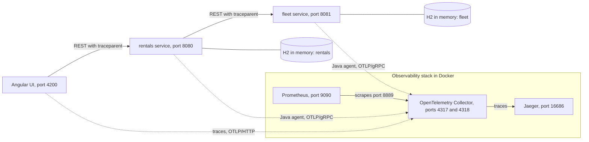
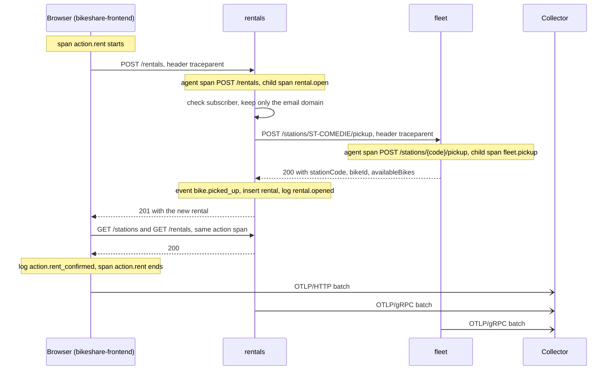
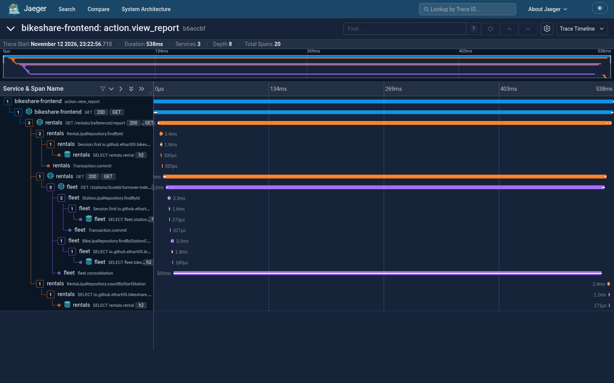

# bikeshare-observability

A small bike-share system, two Spring Boot services and an Angular UI, instrumented end to end with OpenTelemetry. One click in the browser produces one trace across three processes. The structured logs of every process carry the same trace id, the rentals service publishes business metrics, and the Collector strips personal and host data before anything is stored. Everything runs locally: the services on the host, the telemetry backends in Docker.

## Architecture



One "rent" click, with the span each process opens:



| Process    | Port | Role                                              | Service name in Jaeger |
| ---------- | ---- | ------------------------------------------------- | ---------------------- |
| `frontend` | 4200 | Angular UI, talks only to `rentals`               | `bikeshare-frontend`   |
| `rentals`  | 8080 | rental registry, subscribers, billing             | `rentals`              |
| `fleet`    | 8081 | stations and bikes, called only by `rentals`      | `fleet`                |

| Container    | Port                     | Role                                       |
| ------------ | ------------------------ | ------------------------------------------ |
| `collector`  | 4317 (gRPC), 4318 (HTTP) | receives, processes and exports telemetry  |
| `jaeger`     | 16686                    | stores and displays traces                 |
| `prometheus` | 9090                     | stores metrics scraped from the Collector  |

## What is instrumented and how

- **Agent auto-instrumentation.** Both services run with the OpenTelemetry Java agent. It produces the server spans (Tomcat), the outgoing HTTP call from rentals to fleet (JDK HTTP client), and the Spring Data, Hibernate and JDBC spans, with no code change.
- **Manual spans.** `RentalService` opens `rental.open` and `rental.return` with the OpenTelemetry API; `FleetService` opens `fleet.pickup`. They carry business attributes (`bikeshare.rental.reference`, `bikeshare.bike.id`, start and end station), span events (`bike.picked_up`, `bike.dropped_off`), and on failure the step and reason codes plus the recorded exception.
- **`@WithSpan`.** The fleet consolidation step behind the turnover index is a private method annotated `@WithSpan("fleet.consolidation")`, so the agent times it as its own span.
- **Structured logs.** Spring Boot writes one ECS JSON line per event to `logs/<service>.log`. The agent puts `trace_id` and `span_id` in the MDC, so every line points at the span it was written in. The console keeps a short human format with the same two ids at the end of the line. Business events (`rental.opened`, `rental.closed`, `rental.open_failed`, `fleet.pickup_rejected`) are typed and carry only the email domain, never the address or the password.
- **Browser spans.** Each user action opens one span (`action.refresh`, `action.rent`, `action.return`, `action.view_report`), and every `fetch` it triggers becomes a child of that span, even after an `await`. The fetch instrumentation adds `traceparent` to calls to the rentals origin, and rentals allows `traceparent` and `tracestate` in its CORS configuration. The browser logs one JSON line per outcome to the console, with the same `trace_id` and `span_id`.
- **Collector processing.** The Collector deletes the client address, peer address and port, user agent and JVM command line from every span, drops successful CORS preflight spans, and keeps only the application metrics.
- **Custom metrics.** rentals publishes `bikeshare.rentals.opened` (counter) and `bikeshare.rentals.amount` (histogram, EUR), both by start station. Prometheus scrapes them from the Collector.
- **Build-time instrumentation.** A Spoon transformer in `tools/spoon-instrumenter/` adds `@WithSpan` to every public method of a `@Service` class that has no span yet, in a copy of the service sources.

The full list of span names, attributes, failure codes, log fields and metrics is in [docs/telemetry.md](docs/telemetry.md).

## Requirements

Linux was the tested platform. Windows and macOS have not been tried.

| Component                | Tested version                                        |
| ------------------------ | ----------------------------------------------------- |
| JDK                      | 17.0.12 and 21.0.9 (bytecode targets Java 17)         |
| Maven                    | 3.9.6 and 3.9.9                                       |
| Node and npm             | 24.16.0 and 11.13.0                                   |
| Docker and Compose       | 29.1.0 and 2.40.3                                     |
| Chrome                   | 144 (only for `scripts/browser.mjs`)                  |
| OpenTelemetry Java agent | 2.32.0                                                |
| OpenTelemetry Collector  | 0.162.0 (`otel/opentelemetry-collector`)              |
| Jaeger                   | 2.22.0 (`jaegertracing/jaeger`)                       |
| Prometheus               | 3.5.0 (`prom/prometheus`)                             |
| Spring Boot              | 4.1.1                                                 |
| Angular                  | 21.2                                                  |
| Spoon                    | 11.5.0                                                |

OpenTelemetry libraries:

| Side | Library                                                         | Version |
| ---- | --------------------------------------------------------------- | ------- |
| Java | `io.opentelemetry:opentelemetry-bom` and `-api`                 | 1.66.0  |
| Java | `opentelemetry-instrumentation-annotations`                     | 2.32.0  |
| Web  | `@opentelemetry/api`                                            | 1.9.1   |
| Web  | `@opentelemetry/sdk-trace-web`, `sdk-trace-base`, `resources`   | 2.12.0  |
| Web  | `@opentelemetry/browser-instrumentation`                        | 0.8.1   |
| Web  | `@opentelemetry/exporter-trace-otlp-http`, `instrumentation`    | 0.223.0 |
| Web  | `@opentelemetry/semantic-conventions`                           | 1.43.0  |

Java 17 is the minimum. Node must satisfy `^20.19 || ^22.12 || ^24`; `scripts/browser.mjs` needs Node 22 or later for its built-in WebSocket.

## Quick start

All commands run from the repository root unless they `cd frontend`.

Build:

```sh
node scripts/download-agent.mjs
mvn -f fleet/pom.xml clean package
mvn -f rentals/pom.xml clean package
cd frontend && npm ci && cd ..
```

The agent JAR is downloaded, not committed. `npm ci` reads `frontend/.npmrc`, which must stay in place (see [troubleshooting](docs/troubleshooting.md)).

Start, in this order: the stack, then fleet, then rentals, then the UI.

```sh
# terminal 1: Collector, Jaeger and Prometheus
docker compose -f observability/docker-compose.yml up -d

# terminal 1: fleet
node scripts/start.mjs fleet --agent

# terminal 2: rentals
node scripts/start.mjs rentals --agent

# terminal 3: the UI
cd frontend && npm start
```

Without `--agent` the same JAR runs without telemetry, and log lines have empty `trace_id` and `span_id`. Any other argument is passed to the JVM. The root `package.json` has shortcuts: `npm run observability`, `npm run fleet`, `npm run rentals`, `npm run frontend`.

To run both services in the background, which the extended scenarios require:

```sh
node scripts/stack.mjs start
node scripts/stack.mjs stop
node scripts/stack.mjs restart fleet -Dfleet.consolidation-ms=1200
```

| URL                      | What                |
| ------------------------ | ------------------- |
| <http://localhost:4200>  | the UI              |
| <http://localhost:16686> | Jaeger              |
| <http://localhost:9090>  | Prometheus          |

To stop everything: `node scripts/stack.mjs stop`, `Ctrl-C` in the terminals, then `docker compose -f observability/docker-compose.yml down`.

## Scenarios

The databases live in memory. `verify-functional.mjs` needs a fresh fleet: restart the services between two runs.

```sh
node scripts/scenarios.mjs            # core scenarios 1 to 7
node scripts/verify-functional.mjs    # functional baseline, 24 checks
node scripts/extended-scenarios.mjs   # scenarios 8 to 11 (services started by stack.mjs)
node scripts/browser.mjs              # real clicks in a headless Chrome
```

| #  | Scenario                        | What it shows                                                           | Signal                                            |
| -- | ------------------------------- | ----------------------------------------------------------------------- | ------------------------------------------------- |
| 1  | happy path                      | the working case, end to end                                            | one trace, no error                               |
| 2  | open a rental                   | a business milestone the agent cannot see                               | `rental.open`, log `rental.opened`                |
| 3  | empty station                   | a rejection, not an outage (409)                                        | reason `no_bike_available`                        |
| 4  | out-of-service station          | a failure caused by the other service (503)                             | reason `station_out_of_service` in fleet          |
| 5  | rejected subscriber             | a secret actually sent, and never logged (401)                          | step `subscriber_check`                           |
| 6  | rental report                   | the slow operation                                                      | `fleet.consolidation` duration                    |
| 7  | return the bike                 | closing: duration and amount                                            | `rental.return`, log `rental.closed`              |
| 8  | unknown station                 | a 404 decided by the fleet                                              | `fleet.pickup` in error, both logs                |
| 9  | invalid request                 | a 400 that never reaches the service, with email and secret in the body | agent span only, privacy sentinel at zero         |
| 10 | fleet down                      | the same 503 as scenario 4, for another cause                           | reason `fleet_unreachable`, no fleet span         |
| 11 | slow consolidation (1200 ms)    | control experiment: one parameter changes                               | only `fleet.consolidation` grows                  |

`extended-scenarios.mjs` prints the trace id of each scenario and writes them to `logs/extended-scenarios.json`. It stops and restarts fleet itself and leaves the services running.

`browser.mjs` plays, on a fresh page: page load, rent at `ST-COMEDIE`, report twice (cold and warm), return, rent at `ST-GARE`, rent at `ST-PEYROU`. It prints the trace ids and writes `logs/frontend.log` and `logs/actions.json`. Without Chrome, do the same clicks by hand: the UI shows the trace id under the result of each action, and the JSON lines in the browser console (F12) can be copied into `logs/frontend.log`.

Expected functional values (stations, bike ids, fares, the six rejections) are listed in [scripts/README.md](scripts/README.md#5-expected-functional-values).

## Verification

Unit tests:

```sh
mvn -f fleet/pom.xml test                      # 12 tests
mvn -f rentals/pom.xml test                    # 24 tests
cd frontend && npm test                        # 19 tests
mvn -f tools/spoon-instrumenter/pom.xml test   # 4 tests
```

They pass on Java 17.0.12 and 21.0.9, including with an empty local Maven repository (`-Dmaven.repo.local=<empty dir>`).

On fresh services with the stack running:

```sh
node scripts/verify-functional.mjs
node scripts/browser.mjs
node scripts/verify-telemetry.mjs
node scripts/verify-privacy.mjs --logs logs
```

Expected: `(24 checks)` all OK, the 24 telemetry checks OK, and the privacy sentinel at zero on every source.

| Property                                     | Where it is checked                                                              |
| -------------------------------------------- | -------------------------------------------------------------------------------- |
| functional behaviour                         | `verify-functional.mjs`                                                          |
| structured logs                              | `verify-telemetry.mjs`, "Structured logs"; `RentalServiceLoggingTest`            |
| privacy                                      | `verify-privacy.mjs`; `InvalidRequestTest`                                       |
| agent coverage                               | `verify-telemetry.mjs`, "Agent auto-instrumentation"                             |
| manual spans                                 | `verify-telemetry.mjs`, "Manual spans"                                           |
| context propagation                          | `verify-telemetry.mjs`, "Context propagation"; `rentals-store-telemetry.spec.ts` |
| log-trace correlation                        | `verify-telemetry.mjs`, "Log-trace correlation"                                  |
| scenarios                                    | `scenarios.mjs` and `extended-scenarios.mjs`                                     |
| diagnostics                                  | `evidence/diagnostics/`                                                          |
| reproducible from a clean checkout           | all commands above                                                               |

## Logs

| File                | Content                                                    |
| ------------------- | ---------------------------------------------------------- |
| `logs/rentals.log`  | rentals structured log, one ECS JSON line per event        |
| `logs/fleet.log`    | the same for fleet                                         |
| `logs/frontend.log` | browser console, copied by `browser.mjs`                   |
| `logs/*.out`        | console of the JVMs started by `stack.mjs`, agent included |

Files accumulate across runs. Delete `logs/` to start from scratch.

## Following one trace id

In Jaeger, pick service `bikeshare-frontend`, operation `action.rent`. Or, with a known id:

```sh
node scripts/read-trace.mjs --trace <traceId>
node scripts/read-trace.mjs --service rentals --all
```

From the trace to the logs of all three processes:

```sh
node scripts/trace-logs.mjs --log logs/frontend.log --trace <traceId>
node scripts/trace-logs.mjs --log logs/rentals.log --trace <traceId>
node scripts/trace-logs.mjs --log logs/fleet.log --trace <traceId>
node scripts/correlate.mjs <traceId>
```

`correlate.mjs` puts each log line next to the span it was written in. `verify-telemetry.mjs` makes the same comparison and says whether it holds. `logs/actions.json` gives the trace id of every browser action.

## Worked diagnoses

**A slow report.** Take the `report (warm)` action from `logs/actions.json`: the second report, which does not pay for JVM warm-up.

```sh
node scripts/read-trace.mjs --trace <traceId of "report (warm)">
```

The trace goes `action.view_report` -> `GET /rentals/{reference}/report` -> `GET /stations/{code}/turnover-index` -> `fleet.consolidation`. The consolidation span alone takes about 500 ms, more than 60% of the report. Its `bikeshare.fleet.consolidation_ms` attribute matches the configured value. Scenario 11 is the control experiment: with `-Dfleet.consolidation-ms=1200`, only that span grows.



*A warm `action.view_report` trace in Jaeger: three services, 20 spans, and the 500 ms `fleet.consolidation` bar spanning almost the whole request.*

**A 503 on renting from an out-of-service station.** Take `rent (out-of-service station)`, then read the three logs with the same id.

```sh
node scripts/read-trace.mjs --trace <traceId>
node scripts/trace-logs.mjs --log logs/frontend.log --trace <traceId>
node scripts/trace-logs.mjs --log logs/rentals.log --trace <traceId>
node scripts/trace-logs.mjs --log logs/fleet.log --trace <traceId>
```

`action.rent`, `rental.open` and `fleet.pickup` are all in error with `station out of service: ST-PEYROU`. fleet logs `fleet.pickup_rejected` (WARN, reason `station_out_of_service`) under the `fleet.pickup` span. rentals logs `rental.open_failed` (ERROR, step `fleet_pickup`, reason `fleet_unavailable`). The browser logs `action.failed` with category `rejected` and HTTP status 503. The decision was made in fleet, not in rentals; scenario 10 gives the same 503 with reason `fleet_unreachable` and no fleet span at all.

## Capturing evidence

With the UI running (`cd frontend && npm start`):

```sh
node scripts/capture-evidence.mjs
```

The script recreates the stack, restarts the services, runs everything above and writes the results to `evidence/`: functional and scenario output in `logs/`, one trace per action and the correlation reports in `traces/`, the two diagnoses and rentals by station in `diagnostics/`, the Collector comparison in `collector/`, Prometheus queries in `metrics/`, and the instrumenter comparison in `instrumenter/`. It takes about ten minutes and overwrites the previous `evidence/`. Ids change between runs; everything else should match.

## Collector before and after

The processors are on by default in `observability/otel-collector-config.yaml`. To compare, on the same trace, what arrives at the Collector and what Jaeger stores:

```sh
node scripts/compare-collector.mjs prepare
node scripts/stack.mjs start
node scripts/browser.mjs
node scripts/compare-collector.mjs measure
node scripts/compare-collector.mjs finish
```

`prepare` restarts the Collector with `observability/docker-compose.comparison.yml`, which adds a second pipeline writing every incoming span to `observability/comparison/raw.jsonl`. `finish` restores the normal Collector and deletes that file, since it holds exactly what the pipeline removes.

## Metrics

rentals publishes `bikeshare.rentals.opened` and `bikeshare.rentals.amount` by start station. The Collector exposes them to Prometheus. Queries to try at <http://localhost:9090>:

```promql
sum by (bikeshare_rental_start_station) (bikeshare_rentals_opened_total)
sum by (bikeshare_rental_start_station) (bikeshare_rentals_amount_EUR_sum)
sum by (le) (bikeshare_rentals_amount_EUR_bucket)
count({__name__=~"bikeshare_.*"})
```

## Spoon instrumenter

The rule: every public method of a `@Service` class gets `@WithSpan`, named after the operation (`FleetService.turnoverIndex` becomes `fleet.turnover_index`), unless it already has a span. The tool writes a transformed copy; the committed sources stay hand-written.

```sh
mvn -f tools/spoon-instrumenter/pom.xml compile exec:java -Dexec.args=fleet
mvn -f tools/spoon-instrumenter/target/fleet-instrumented/pom.xml clean package
FLEET_JAR=tools/spoon-instrumenter/target/fleet-instrumented/target/fleet.jar node scripts/stack.mjs start
```

On fleet it adds `fleet.stations`, `fleet.station`, `fleet.available`, `fleet.drop_off` and `fleet.turnover_index`, and leaves `pickUp` alone because it already builds `fleet.pickup`.

## Troubleshooting

See [docs/troubleshooting.md](docs/troubleshooting.md).

## Known limitations

- The browser log lives in its console. Only `scripts/browser.mjs` copies it to a file.
- The station code sent by the caller appears as is in span attributes and failure logs, with no length limit.
- A failed read (`GET /stations`, report) has no business log line, only the agent spans.
- Jaeger and the H2 databases are in memory: everything is lost on shutdown.
- Counting from the logs only covers the retained period.

## Project layout

```text
.
├── fleet/                     fleet service (Spring Boot, port 8081)
├── rentals/                   rentals service (Spring Boot, port 8080)
├── frontend/                  Angular UI (port 4200)
├── observability/             Compose file, Collector and Prometheus configuration
├── tools/spoon-instrumenter/  build-time @WithSpan transformer
├── scripts/                   start, scenarios, verification and evidence scripts
├── docs/                      telemetry reference, troubleshooting, screenshot
└── package.json               npm shortcuts
```
